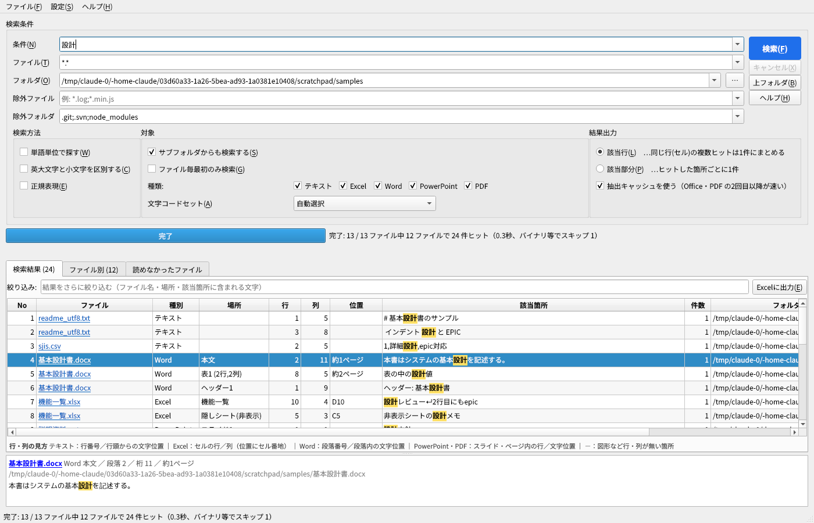

# Grep ツール（設計書・ソース横断検索）

Excel / Word / PowerPoint / PDF の設計書と、ソースコード・XML・CSV などのテキストファイルを
まとめて grep し、結果を画面で確認・Excel に出力できる Windows 向けデスクトップツールです。



## できること

| 項目 | 内容 |
|---|---|
| 対象ファイル | **Excel** .xlsx .xlsm .xls ／ **Word** .docx .docm .doc ／ **PowerPoint** .pptx .pptm .ppt ／ **PDF** ／ **テキスト**（上記以外の拡張子すべて。.txt .csv .xml .java .sql .html .js .py など） |
| 新旧形式 | 旧形式（.xls .doc .ppt）も **Office をインストールしていなくても** 検索できます（ファイルを直接解析） |
| 検索範囲 | Excel：セル・コメント・図形/テキストボックス（グループ化・吹き出し含む）・非表示シート ／ Word：本文・表・図形/テキストボックス（グループ化・Word2003形式の図形含む）・ヘッダー/フッター・脚注・コメント ／ PowerPoint：スライド・ノート ／ PDF：各ページの文字 |
| 文字コード | 自動判定（UTF-8 / Shift_JIS / EUC-JP / UTF-16 / JIS）。手動指定も可。バイナリファイルは自動でスキップ |
| 結果表示 | ファイル・種別・場所・**行・列**・位置・該当箇所（ヒット部分を黄色で強調）・件数・フォルダ・更新日時 |
| ファイルを開く | 結果の **ファイル名（青字）をクリック** → 該当箇所を開く。Excel はシート＋セル、Word は段落、PowerPoint はスライドへ移動（pywin32 使用）。テキストは設定したエディタで行・桁へジャンプ |
| Excel 出力 | 4シート構成（検索結果／ファイル別／読めなかったファイル／検索条件）。ファイル名・フォルダはクリックで開けるリンク。Excel ファイルへのリンクは該当セルへ直接飛ぶ。ヒット部分は赤太字 |
| 残り時間 | 進捗バー（%）と「残り 約N秒」、処理済み/全ファイル数、ヒット件数、経過時間、処理中のファイルを表示 |
| 速さ | CPU コア数に応じて並列検索。Office/PDF から取り出した文字は **抽出キャッシュ** に保存し、2回目以降は数倍速くなる（更新されたファイルは自動で読み直し） |

### 行・列の見方（テキスト以外の扱い）

テキスト以外は「行・列」の意味が形式ごとに異なるため、**場所** 列で「どこの」行・列かを示し、
画面下部・ヘルプ・Excel 出力の「検索条件」シートに凡例を出しています。

| 種別 | 場所 | 行 | 列 | 位置（補足） |
|---|---|---|---|---|
| テキスト | － | 行番号 | 行頭からの文字位置（桁） | － |
| Excel | シート名（非表示シートは「(非表示)」付き） | セルの行 | セルの列（数字） | セル番地（例 B12）／コメント／図形名 |
| Word | 本文 ／ 表n(行,列) ／ ヘッダー・脚注など | 段落番号 | 段落内の文字位置 | ページ（目安） |
| PowerPoint | スライドn ／ スライドn ノート | スライド内の行 | 文字位置 | － |
| PDF | nページ | ページ内の行 | 文字位置 | － |

図形やテキストボックス内の文字は行・列が無いので「－」を表示し、位置欄に図形名と置かれている場所を出します（Excel は「図形: 遷移説明（H3付近）」、Word は「図形: 承認フロー枠（段落7付近） 約1ページ」）。.xls/.doc は図形名を持たないため「図形」と表示します。

### 画面の見方

- **検索条件**：条件／ファイル（`*.*`、`*.xlsx;*.docx` のように `;` 区切り）／フォルダ（`;` 区切りで複数可、ドラッグ＆ドロップ可）／除外ファイル／除外フォルダ（既定 `.git;.svn;node_modules`）。入力履歴はドロップダウンから選べます。
- **検索方法**：単語単位／大文字小文字を区別／正規表現（Python 形式）
- **対象**：サブフォルダ／ファイル毎最初のみ／種類（テキスト・Excel・Word・PowerPoint・PDF のオン/オフ）／文字コードセット
- **結果出力**：該当行（同じ行・セルの複数ヒットは1件にまとめ、件数列に数を表示）／該当部分（ヒットごとに1件）
- **結果タブ**：検索結果／ファイル別（ヒット件数）／読めなかったファイル（パスワード付き・破損・アクセス権なし・画像だけの PDF など、理由付き）
- 結果の上の **絞り込み** 欄で、検索結果をさらに文字で絞れます（Excel 出力も絞り込み後の内容になります）。
- 行を選ぶと下のプレビューに該当箇所を表示（テキストは前後3行）。右クリックで「フォルダを開く」「フルパスをコピー」など。
- ショートカット：Enter＝検索、Esc＝キャンセル、Ctrl+E＝Excel 出力、F1＝ヘルプ、Ctrl+C＝選択行をコピー

## 使い始める

### A. exe を作って配布する（おすすめ）

1. Windows に Python 3.10 以上をインストール（https://www.python.org/downloads/ 、「Add python.exe to PATH」にチェック）
2. このフォルダで `build_exe.bat` をダブルクリック
3. `dist\GrepTool\GrepTool.exe` ができます。**`dist\GrepTool` フォルダごと** 配布してください（Python 不要で動きます）

### B. Python から直接起動する

`setup_and_run.bat` をダブルクリック（初回だけ必要なライブラリを自動で入れます）。
手動なら：

```bat
py -3 -m venv .venv
.venv\Scripts\pip install -r requirements.txt
.venv\Scripts\python GrepTool.py
```

`GrepTool.exe C:\work\設計書` のようにフォルダを引数にすると、そのフォルダが入った状態で起動します。

### テキストを開くエディタの設定

メニュー「設定」→「エディタ・キャッシュの設定」で、サクラエディタ・秀丸・VS Code・Notepad++ のプリセットを選べます。
サクラエディタ等が標準の場所にあれば初回起動時に自動で設定されます。`{path}` `{line}` `{col}` が置き換わります。

## 設計上の選択

| 論点 | 採用した方式 | 理由 |
|---|---|---|
| 旧形式（.xls .doc .ppt） | Office 不要の直接解析（.xls は xlrd、.doc/.ppt は OLE を自前解析） | 速い・Office の有無やバージョンに左右されない・Office の起動ダイアログで止まらない |
| 新形式（.xlsx .docx .pptx） | ZIP 内の XML を直接ストリーム解析 | 汎用ライブラリより大幅に速い。図形・コメント・非表示シートも拾える |
| PDF | pypdfium2（Chrome と同じ PDFium） | 高速・日本語に強い・商用利用しやすいライセンス |
| インデックス | 「抽出キャッシュ」方式（Office/PDF の抽出結果を SQLite に保存） | 本格的な全文インデックスは事前作成・更新の手間が UI を複雑にするため。キャッシュは検索のたびに自動で作られ、ユーザーは意識不要 |
| 並列化 | プロセス並列（CPU コア数－1、最大12） | Office 解析は CPU を使うため、スレッドではなくプロセスで並列化 |
| 該当位置で開く | pywin32 経由で Office を操作（無ければ普通に開く） | 追加設定なしで「クリック→該当セル」が実現できる |

参考計測（4コアの Linux 環境、ファイルはOSキャッシュ済み）：ソース 20,000 ファイル（650MB）＋ Office/PDF 2,100 ファイルを約 2.6 秒。
Office/PDF 2,100 ファイルのみでは初回 1.0 秒 → キャッシュ利用時 0.2 秒。実際の速度はディスクやネットワークドライブの速さに左右されます。

## 制限事項・注意

- **Word のページ番号は目安** です（ページ割りは Word の表示レイアウトで決まるため、Word が保存時に記録した改ページ位置から概算）。.doc は手動改ページのみ考慮します。正確な位置は「段落番号」を使ってください。
- **.doc の段落番号** は表の行末記号も数えるため、表を含む文書では Word 上の段落番号と少しずれることがあります。
- **PDF** は文字情報を持つものだけが対象です。スキャン画像だけの PDF は「読めなかったファイル」に理由付きで表示します（OCR は未対応）。PDF の「行」は PDF 内部の文字の並び順に依存します。
- **パスワード付きファイル** は検索できません（「読めなかったファイル」に表示）。
- Excel の数値・日付セルは保存されている値で検索します（.xlsx の日付はシリアル値）。数式そのものは検索対象外で、計算結果の値を検索します。
- .xlsb、.vsdx（Visio）、.msg などは対象外です。
- ヒットが極端に多い場合、1ファイル 5,000 件・全体 300,000 件で打ち切ります（画面に表示します）。
- 正規表現は Python 形式です（サクラエディタの bregonig/Onigmo とは一部書き方が異なります）。

## ファイル構成

```
GrepTool.py              起動スクリプト
build_exe.bat            exe 作成（PyInstaller）
setup_and_run.bat        Python から起動（初回は環境を自動作成）
requirements.txt         必要ライブラリ
greptool/
  gui.py                 画面
  engine.py              ファイル列挙・並列検索・残り時間の見積もり
  searcher.py            検索処理（ワーカープロセス側）
  extractors.py          テキスト・xlsx・xls・docx・pptx・PDF の抽出、文字コード判定
  oldoffice.py           .doc / .ppt の直接解析
  cache.py               抽出キャッシュ（SQLite、%LOCALAPPDATA%\GrepTool）
  excel_export.py        Excel 出力
  opener.py              該当位置で開く（Office 操作・エディタ起動）
tests/make_testdata.py   実運用を想定したテストデータの作成（期待結果も定義）
tests/check_testdata.py  テストデータを検索して期待結果と自動照合
testdata/                作成済みのテストデータ（README_テストデータ.md に検索語と期待結果）
tests/make_samples.py    簡易サンプル作成（開発用）
```

exe 化後の動作確認には、画面を出さずに検索だけ行うモードがあります：
`GrepTool.exe --selftest C:\対象フォルダ 検索語` → カレントフォルダに `greptool_selftest.txt` を出力。
